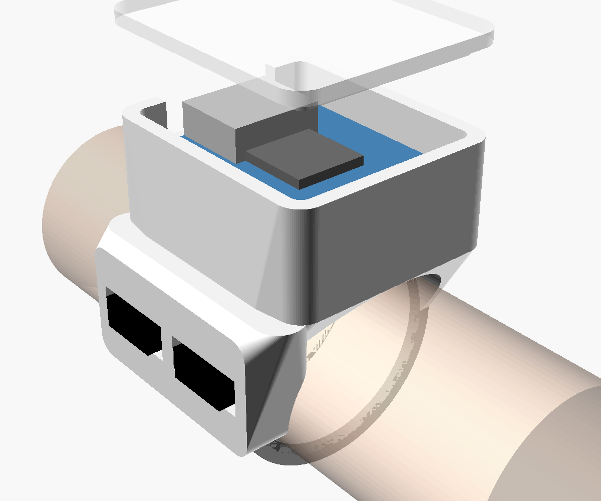
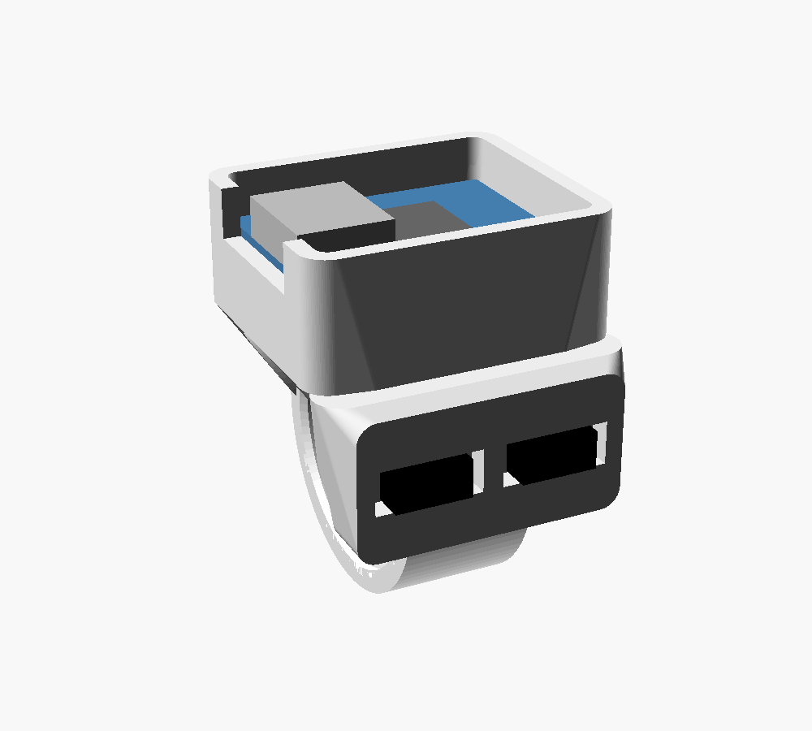
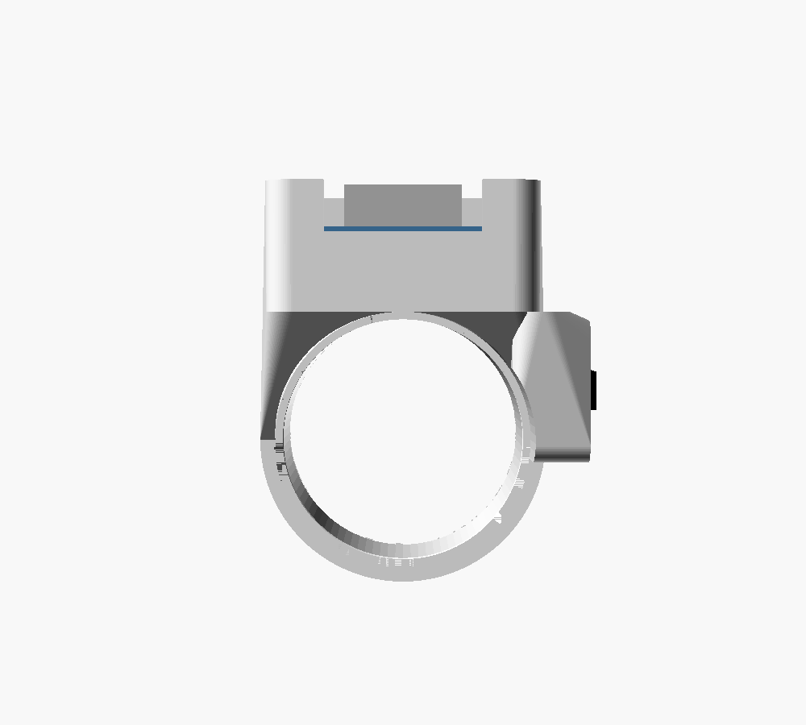

# Gesture Ring v1 – a ring that controls your computer

A ring worn on the index finger that works as a **Bluetooth mouse and
keyboard**. Small hand movements move the cursor, and your thumb presses two
buttons on the side of the ring for clicks, scrolling and gesture macros.
Your hand stays **resting** on the desk, an armrest or your lap. There's no
arm‑in‑the‑air movement.



## Project status

| Item | State |
|---|---|
| Concept and interaction design | Defined (below) |
| Electronics selection | Done |
| 3D housing (`gesture_ring.scad` + STLs) | v1 done, rendered and section‑checked. **Not printed yet.** |
| Firmware | **Not started.** Planned once the parts arrive (see [Software plan](#software-plan)). |

---

## 1. How it's meant to feel

- **Rest, don't hover.** Your forearm and wrist stay supported. The cursor
  responds to **small rotations** of your wrist and index finger, measured by
  a gyroscope inside the ring, like a laser pointer but much more subtle. A
  pointer‑speed curve makes tiny motions precise and quicker ones travel far.
- **Thumb does the clicking.** When your hand is relaxed, your thumb naturally
  rests against the side of your index finger. The ring puts two buttons
  exactly there.
- **The cursor moves only when you ask it to.** Hold the front button to move
  the cursor (a "clutch"). Let go and you can move your hand freely, type or
  pick up a cup, and nothing happens. This is the most important rule for
  avoiding accidental input.
- **No drivers.** The ring connects as a standard **Bluetooth mouse and
  keyboard**, so it works on Windows, macOS, Linux, iPad and Android. Macros
  are sent as normal key presses.

### Proposed controls (firmware v1, all remappable)

| Action | Result |
|---|---|
| **Hold A** + small hand movement | Move the cursor |
| **Tap A** | Left click |
| **Double‑tap A, then hold** + move | Drag |
| **Tap B** | Right click |
| **Hold B** + tilt finger up or down | Scroll |
| **Hold B** + quick flick right | `Enter` |
| **Hold B** + quick flick left | `Backspace` (or browser Back) |
| **Hold B** + quick flick up | Dictation (Windows `Win+H`; on macOS, set a custom dictation shortcut and map it) |
| **Hold B** + quick flick down | `Esc` |
| **Hold B** + twist (roll) the finger | Switch windows / app switcher |
| **Press A + B together** | Pause or resume the ring |
| *(later)* Double‑tap the finger on the desk | Optional macro. Off by default to avoid accidental triggers. |

**A** is the button nearer your fingertip, and **B** is the one nearer your
knuckle. Gestures only fire while **B is held**, so everyday hand movements
never trigger anything.

---

## 2. Electronics

### Architecture

```
  thumb buttons A, B ──► Seeed XIAO nRF52840 Sense ◄── LiPo cell (charges over USB-C)
                          ├─ nRF52840: Bluetooth LE, mouse + keyboard
                          └─ LSM6DS3TR-C 6-axis IMU (gyroscope + accelerometer)
                                       │
                                       ▼  Bluetooth
                          PC / Mac / tablet (no driver needed)
```

The **XIAO nRF52840 *Sense*** is the key part. One 21 × 17.8 mm board has:

- Bluetooth Low Energy, which lets it act as a mouse and keyboard
- the motion sensor (a 6‑axis IMU)
- a LiPo battery charger (BQ25101, 50 or 100 mA)
- a USB‑C port for charging and programming

It's the smallest off‑the‑shelf board with all of these. Make sure to buy the
**Sense** version: the plain version has **no IMU**.

### Parts list

| Qty | Part | What to look for | Approx. price |
|---|---|---|---|
| 1 | **Seeed XIAO nRF52840 Sense** | Must say "Sense". Many listings include header pins; you won't use them. | $15–18 |
| 1 | **LiPo cell, 3.7 V, "401012" (~50 mAh)** | 4.0 × 10 × 12 mm, **with a protection circuit** and wire leads. A "301012" (3 mm, ~40 mAh) also fits and makes the ring 1 mm lower; set `bat_t = 3.0`. | $3–5 |
| 2 | **Tactile switch, 3 × 6 × 2.5 mm** (2‑pin) | Small surface‑mount or through‑hole type; buy a pack | ~$2 / pack |
| 1 | **Thin wire**: 30 AWG silicone or enamelled (magnet) wire | For the switches and battery | ~$3 |
| 1 | **Kapton tape** | Insulates the battery from the bottom of the board | ~$3 |
| – | Small dab of hot glue or CA glue | Holds the board and switches in place | – |
| – | USB‑C cable (data) | Charging and programming | have |

**Electronics total: about $25–30.**

**Tools:** a fine‑tip soldering iron, solder, flush cutters and tweezers.
Soldering is required, but it's only 6 joints.

### Wiring

```
 Battery +  (red)   ──►  BAT+ pad  (underside of the XIAO)
 Battery −  (black) ──►  BAT− pad  (underside of the XIAO)

 Switch A:  one leg ──►  D0      other leg ──►  GND
 Switch B:  one leg ──►  D1      other leg ──►  GND
```

- The switches use the chip's internal pull‑up resistors, so no other parts
  are needed.
- Check the battery polarity twice. A reversed LiPo can damage the board.
- Put Kapton tape between the battery and the underside of the board.
- Charging happens over the XIAO's USB‑C port. Its default 50 mA charge rate
  is about 1C for a 50 mAh cell, which is fine.
- There's no power switch. The firmware will put the ring into deep sleep
  after inactivity and wake it on a button press.

### Battery life (estimate)

- **In use:** Bluetooth plus the gyroscope draw about 2–4 mA, so a 50 mAh cell
  lasts roughly **12–20 hours of active use**.
- **Asleep:** standby is measured in days to weeks, with the accelerometer
  watching for motion to wake up.

These are estimates to confirm with real measurements.

---

## 3. The housing

| Thumb side (switch pockets) | From the fingertip (USB‑C notch on top, thumb lobe on the right) |
|---|---|
|  |  |

**Layout** (right hand, worn on the **base segment of the index finger**):

- **Top pod:** the XIAO board sits on side ledges, with the LiPo cell
  underneath it in the space between the ledges.
  - The USB‑C port points toward the fingertip for charging.
  - A clip‑in lid closes the top. Print the lid in **translucent** filament so
    the board's status LEDs show through.
- **Thumb lobe:** this is on the side of the ring facing the thumb. Two switch
  pockets sit side by side along the finger. Internal wire channels run from
  each pocket up into the pod.
- **Band:** 1.8 mm thick and 10 mm wide, with rounded inner edges for comfort.
  The pod overhangs the band toward the knuckle and fingertip, with extra
  clearance underneath so it doesn't press on the finger when it bends.

**Size with default parameters (US size 9):**

| Measurement | Value |
|---|---|
| Inner diameter | 19.1 mm |
| Pod footprint | 21.1 × 24.3 mm |
| Pod height above the finger | 11.8 mm |
| Thumb lobe | stands about 3 mm off the band |

**Be realistic about the size.** This v1 is a **prototype**, about the size of
a chunky signet ring, not a slim Oura‑style band. A slim ring needs a custom
curved circuit board and a curved battery (see the roadmap). The goal of v1 is
to prove the controls and software comfortably first.

### Files

| File | What |
|---|---|
| `gesture_ring.scad` | Parametric OpenSCAD source |
| `stl/sizer.stl` | Plain band with the same inner diameter. **Print this first** to check the fit. |
| `stl/ring.stl` | Ring housing, already oriented for printing (pod opening face‑down) |
| `stl/lid.stl` | Pod lid |

Re‑export after changing parameters:

```bash
openscad -D 'part="sizer"' -o stl/sizer.stl gesture_ring.scad
openscad -D 'part="ring"'  -o stl/ring.stl  gesture_ring.scad
openscad -D 'part="lid"'   -o stl/lid.stl   gesture_ring.scad
```

### Key parameters

| Parameter | Meaning |
|---|---|
| `ring_size_us` | Your **US ring size** for the index finger. Inner diameter = 11.63 + 0.8128 × size. |
| `hand` | `"right"` or `"left"`. Mirrors the thumb lobe to the correct side. |
| `size_fudge` | Extra inner diameter to allow for printing tolerance (default 0.2 mm) |
| `bat_t`, `bat_w`, `bat_l` | Battery size. Measure yours. |
| `usb_h`, `xiao_pcb` | Board heights. Measure your XIAO with calipers. |
| `sw_*` | Switch pocket size, for a different switch |
| `lobe_out`, `lobe_z0/z1` | Size and position of the thumb lobe |

The model checks itself: it refuses to render if the battery doesn't fit or
the switches don't fit the lobe.

### Printing

- **Best:** resin (SLA) in a tough or ABS‑like resin. Rings are small and
  benefit from the detail.
- **FDM:** PETG, with a 0.4 mm nozzle (0.2 mm is better), 0.12 mm layers and
  100 % infill. PLA works for test fits but can crack at 1.8 mm thick.
- The ring STL is already oriented with the pod opening on the bed, so it
  needs no supports apart from the gentle arch of the finger opening.
- **Sizing:** print `sizer.stl` first. Wear it for a few minutes, including
  bending your finger. Adjust `ring_size_us` or `size_fudge` until it feels
  right. A ring with a top pod should be **snug**, or it will rotate on the
  finger.

### Assembly

1. **Fit check:** print the sizer and adjust the size. Then print the ring and
   lid.
2. **Test the board on its own first.** Flash a test sketch over USB before
   soldering anything.
3. **Switches:**
   1. Solder about 6 cm of thin wire to each switch leg.
   2. Thread the wires through the channel from the switch pocket into the pod.
   3. Press the switch into its pocket, stem facing out, and fix it with a dab
      of glue.
4. **Battery:**
   1. Put Kapton tape on the underside of the XIAO.
   2. Solder the battery leads to the **BAT+ and BAT− pads**, checking the
      polarity.
   3. Lay the cell in the bay.
5. **Switch wires:** solder them to D0, D1 and GND. The two switch grounds can
   be joined together.
6. **Board:** drop it onto the ledges, USB‑C toward the fingertip opening, and
   fix it with a small dab of hot glue at the corners.
7. **Lid:** press it on. Glue it once everything works.

---

## Software plan

To be built when the parts are here:

1. **Firmware v1**, Arduino with the Seeed nRF52 core. Bluetooth mouse and
   keyboard, the controls in the table above, and a gyroscope‑to‑cursor
   pipeline:
   - an automatic gyroscope zero‑point calibration while the ring is still
   - a dead‑zone
   - a pointer‑speed curve
   - smoothing

   All the button and gesture mappings will live in one table at the top of
   the sketch.
2. **Tuning.** Adjust sensitivity and gesture thresholds on your own hand.
3. **Later:** a small desktop companion app that changes mappings without
   reflashing, plus per‑app macros and recognition of finer "micro‑gestures"
   recorded from your own movements.

## Roadmap ideas

- **Haptic tick:** an 8 mm coin vibration motor for click and mode feedback.
- **Touch strip:** replace a button with a capacitive touch strip, for swipe
  scrolling with the thumb.
- **Slim v2 (Oura‑style):**
  - a custom flexible circuit board wrapped inside the band
  - a curved LiPo
  - an nRF52 chip and IMU in the smallest packages

  This is a much bigger step: a custom PCB, an assembly service and a resin or
  metal shell.

## References

- [Seeed XIAO nRF52840 (Sense) wiki](https://wiki.seeedstudio.com/XIAO_BLE/): pinout, battery pads, charging, IMU
- [CNX Software overview of the XIAO BLE boards](https://www.cnx-software.com/2021/12/02/seeed-xiao-ble-tiny-nrf52840-bluetooth-5-0-imu-sensor-microphone/)
