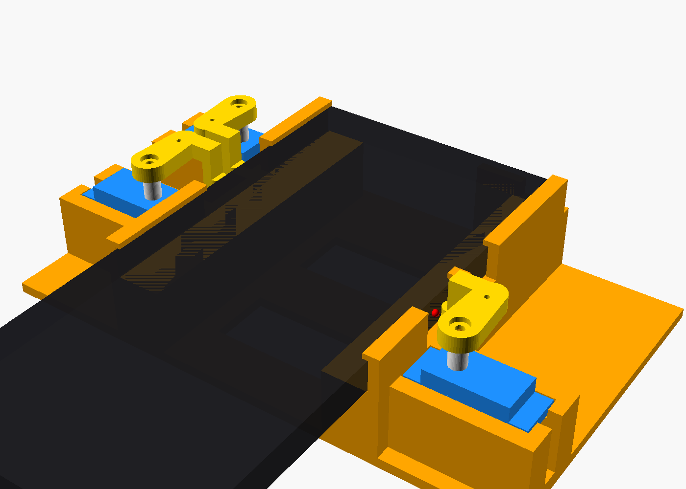
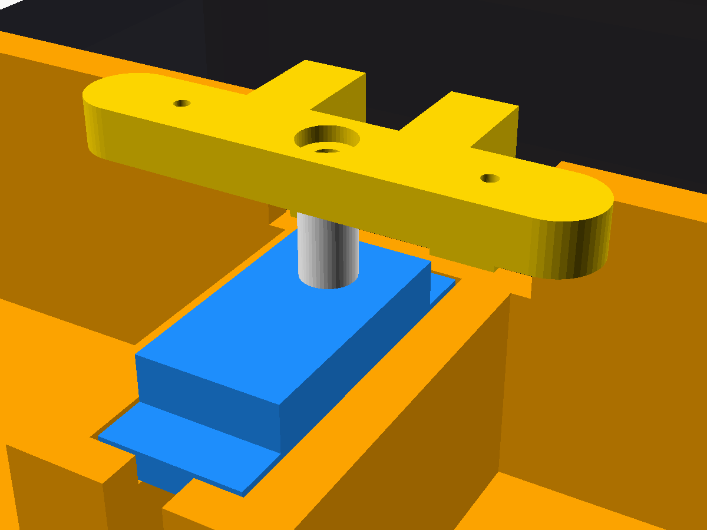
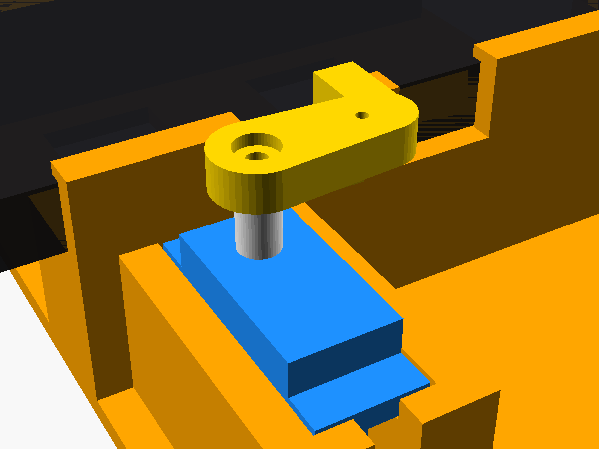

# Phone Claw – servo button presser for a OnePlus 7 Pro

A 3D‑printable saddle that holds a OnePlus 7 Pro (no case) by its long edges.
Three micro servos press **Volume +**, **Volume −** and **Power**. An ESP8266
board drives them, and you control it from a web page, an HTTP API or USB
serial.



## Project status

| Item | State |
|---|---|
| 3D model (`phone_claw.scad` + STLs) | Done, rendered and collision‑checked. **Not printed yet.** |
| Button positions | Measured from a top‑down reference photo (accurate to ~±1 mm) |
| Firmware | Written, and type‑checked with stand‑in libraries. **Not yet compiled or run on real hardware.** |
| Parts | Being ordered |

**To resume:** when the parts arrive, follow [Next steps](#next-steps) from
step 1.

---

## Parts needed

### Electronics

| Qty | Part | Notes |
|---|---|---|
| 1 | **ESP8266 board**: NodeMCU V3 (ESP‑12E) *or* Wemos D1 mini | Either works with the same code. NodeMCU boards often use a CH340 USB chip, which may need its free driver on Windows or Mac. |
| 3 | **SG90 9 g micro servo, 180° version** | Not the 360°/continuous version, which can't hold an angle. Must include horns; the single‑arm horn is used. Optionally buy a spare. |
| 1 | **Electrolytic capacitor, 470–1000 µF, ≥10 V** | Smooths the servo power. Polarised: the stripe side is negative. |
| 1 | **Solderless breadboard** (400 or 830 holes) | Lets all three servos share 5 V and ground without soldering. |
| 1 set | **Dupont jumper wires** (male‑male + male‑female) | 5 male‑to‑female plus 9 male‑to‑male are needed. |
| 1 | **USB cable that carries data** | Micro‑USB on most of these boards. Charge‑only cables can't upload code. |
| 1 | **5 V USB charger, 1 A or more** | Powers everything once it's set up. |

### Hardware and tools

| Qty | Part | Notes |
|---|---|---|
| 3 | **M2 × 8 mm screws** | Fix each printed lever and its horn to the servo shaft (the stock horn screw is too short). Hex socket screws need a 1.5 mm hex key. |
| – | Side cutters or nail clippers | To trim the horns |
| – | Small Phillips screwdriver | For the servo tab screws (included with the servos) |
| – | ~60–80 g PLA or PETG | For printing |
| – | *Optional:* digital calipers | Handy for measuring the servo and checking prints |

**Rough cost, excluding printing:** about $8–15 from budget marketplaces, or
about $25–35 from mainstream retailers that sell multipacks.

---

## Design overview

**Layout.** The phone lies **screen‑up** in a saddle and slides in from the
bottom end until its top edge touches a small stop post. Side walls with thin
lips grip the long edges, the same place you'd hold it by hand. Each servo
stands upright in a pocket beside the phone.

| Side (screen up, top away from you) | Servo | Board pin |
|---|---|---|
| Left – above the volume rocker | Volume + | D5 |
| Left – below the volume rocker | Volume − | D6 |
| Right – below the power key | Power | D7 |

**Mechanism.** A printed 15 mm lever sits on each servo horn. A finger hangs
from its end down to button height and rests 1 mm from the button. When the
servo turns about 8–12°, the finger's rounded pad pushes the button in. The
lever can push up to ~5.8 mm, far more than needed, and the pad lands within
~1.5 mm of the button centre.

**Clearances.**
- The wall has windows wherever a finger reaches the phone.
- The alert slider has its own cut‑out, so sliding the phone in doesn't flip it.
- The top stop post sits on the right of the top edge, clear of the pop‑up
  selfie camera.

| Volume side | Power side | Top view |
|---|---|---|
|  |  |  |

### Button positions used

All distances are measured from the phone's **top edge**:

| Feature | Span | Press point |
|---|---|---|
| Volume rocker | 34.0 → 54.5 mm (split at 43.5) | Vol+ 38.75 mm, Vol− 49.0 mm |
| Power key | 57.5 → 69.0 mm | 63.3 mm |
| Alert slider | ~41 → 49 mm | kept clear (cut‑out 38–52 mm) |

### Printed parts

| File | Part | Print notes |
|---|---|---|
| `stl/claw_base.stl` | Base / saddle, 156 × 95 × 33 mm | Flat on the bed, no supports |
| `stl/arm_vol_up.stl` | Volume + lever | Exported upside down, no supports |
| `stl/arm_vol_dn.stl` | Volume − lever | Exported upside down, no supports |
| `stl/arm_power.stl` | Power lever | Exported upside down, no supports |

Suggested settings: PLA or PETG, 0.2 mm layers, 3 walls, 15–20 % infill.

### Wiring (breadboard, no soldering)

```
 ESP8266 board                    Breadboard
 -------------                    ----------
 VU (or VIN) / 5V ──M‑F wire──►  + rail ──┬── red    (all 3 servos, via M‑M wires)
 G               ──M‑F wire──►  − rail ──┼── brown  (all 3 servos)
                                          └── capacitor across + / − (stripe on −)
 D5 (GPIO14)     ──M‑F wire──►  row A ────── orange  VOLUME UP servo
 D6 (GPIO12)     ──M‑F wire──►  row B ────── orange  VOLUME DOWN servo
 D7 (GPIO13)     ──M‑F wire──►  row C ────── orange  POWER servo
```

- The NodeMCU is too wide for a breadboard, so leave it beside it and use
  male‑to‑female wires.
- Power the servos from **5 V** (VU, VIN or 5V), never 3V3.

### Firmware

`firmware/phone_claw/phone_claw.ino` (Arduino, ESP8266 core, no extra
libraries):

- **Web page:** Volume +, Volume −, Power, Power (hold 3 s), Screenshot
  (Power + Vol −), plus a **Calibrate** section with live sliders. Calibration
  is saved to flash.
- **HTTP:** `/press?b=up|down|power|long|shot&ms=150`
- **Serial (115200):** `u`, `d`, `p`, `P` or `s`
- **WiFi:** joins the network set in the sketch. If it can't, it starts its
  own network called `PhoneClaw` at `192.168.4.1`.
- Servos are switched off after each press, so they don't hum or keep pushing
  on the phone.

---

## Next steps

These need only the purchased parts. Do them before printing.

1. **Test the electronics.**
   1. Wire everything on the breadboard as above.
   2. Install the ESP8266 core in the Arduino IDE (Boards Manager URL:
      `https://arduino.esp8266.com/stable/package_esp8266com_index.json`).
   3. Select **NodeMCU 1.0 (ESP‑12E Module)** or **LOLIN(WEMOS) D1 R2 &
      mini** to match your board.
   4. Set the WiFi name and password in the sketch, then upload.
   5. Open the web page and check that each button moves the right servo.
2. **Measure the servo height.**
   1. Fit a horn and stand the servo on a table.
   2. Measure from the table to the top of the horn.
   3. Set `horn_top_h` in `phone_claw.scad` (default 30 mm) and re‑export.
3. **Trim the horns.** Snip each single‑arm horn to at most **16 mm** from the
   spline centre to its tip.
4. **Optional checks** that can be generated when you resume:
   - A 1:1 paper template to check the press points against the phone.
   - A thin test slice of the base to check how the phone fits (`fit`).
5. **Print** the base and **one** lever. Mount that lever, insert the phone,
   and use the calibration sliders to confirm it clicks its button. Then print
   the other two levers.
6. **Calibrate** each servo on the web page:
   - Set `…Rest` so the finger is just clear of its button.
   - Set `…Press` to the click point plus 2–3°.
   - Save.

### Re‑exporting STLs after edits

```bash
openscad -D 'part="base"'    -o stl/claw_base.stl  phone_claw.scad
openscad -D 'part="arm_up"'  -o stl/arm_vol_up.stl phone_claw.scad
openscad -D 'part="arm_dn"'  -o stl/arm_vol_dn.stl phone_claw.scad
openscad -D 'part="arm_pwr"' -o stl/arm_power.stl  phone_claw.scad
```

The model checks itself: it refuses to render if any parts would collide.

### Tuning parameters (`phone_claw.scad`)

| Parameter | Effect |
|---|---|
| `*_from_top` | button positions |
| `fit` | grip tightness (default 0.4 mm per side) |
| `horn_top_h` | finger height; set from the measured servo |
| `horn_reach` | how far the horns were trimmed |
| `gap` | finger‑to‑button distance at rest |
| `reach` | lever length (longer gives more push but more sideways slide) |
| `slide_comp_vol/pwr` | how far past the target each finger starts, to offset that slide |
| `deck_h` | phone height above the table |
| `stop_x0/stop_x1` | position of the top stop (keep it clear of the pop‑up camera) |
